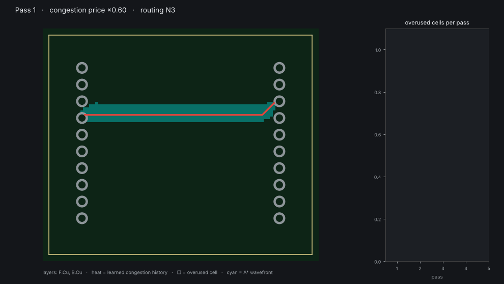
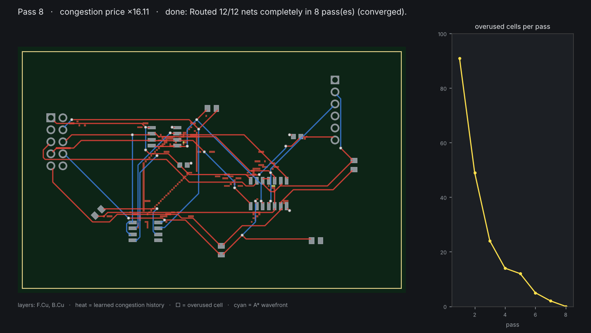
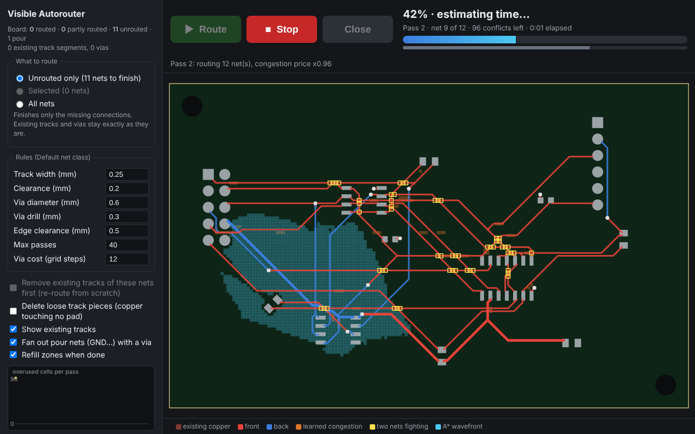

# Visible Autorouter for KiCad

A multi-pass PCB autorouter that runs **inside KiCad** (toolbar button) or from the
command line, routes **all nets or just the ones you select**, and **shows its
thinking** while it works.



*Pass 1: every net takes its own shortest path and nets pile on top of each other
(yellow squares). Each later pass raises the price of contested copper. The
orange heat is the congestion "memory" the router has learned. Nets that have
alternatives move away; the curve on the right shows the overuse falling to
zero.*

## Get it

```bash
git clone https://github.com/imsaiguy/autorouter.git
```

or use **Code ▸ Download ZIP** on https://github.com/imsaiguy/autorouter. The
plugin is the `kicad_autorouter` folder; installation is described below.

### Install or update on Windows in one go (KiCad 10)

Save your work, then paste this into PowerShell. It closes KiCad, downloads the
latest version and installs it (the same block installs the first time and
updates afterwards):

```powershell
Get-Process python*, pythonw* -ErrorAction SilentlyContinue | Where-Object { $_.Path -like "*KiCad*" } | Stop-Process -Force
Get-Process kicad*, pcbnew*, eeschema* -ErrorAction SilentlyContinue | Stop-Process
Remove-Item -Recurse -Force "$env:TEMP\autorouter" -ErrorAction SilentlyContinue
Invoke-WebRequest https://github.com/imsaiguy/autorouter/archive/refs/heads/main.zip -OutFile "$env:TEMP\autorouter.zip"
Expand-Archive "$env:TEMP\autorouter.zip" "$env:TEMP\autorouter" -Force
"y" | & "C:\Program Files\KiCad\10.0\bin\python.exe" -u "$env:TEMP\autorouter\autorouter-main\kicad_autorouter\install_plugin.py"
```

Then start KiCad and open a board. The router's log should say
**"Search core: compiled (fast)"**.

## What it does

* **Three scopes:**
  * **Unrouted only** (the default): finishes just the missing connections,
    i.e. the ratsnest. **Existing tracks and vias are never moved or
    removed.** Partly routed nets get only their missing links, and new
    copper joins onto what's there.
  * **Selected:** the nets of the selected footprints, pads or tracks.
  * **All nets.**

  For *Selected* and *All* you can tick **Remove existing tracks** to re-route
  those nets from scratch. Otherwise existing copper is kept: connected pieces
  count as one terminal, and other nets' tracks are obstacles.
* **Global then detailed routing.** A coarse stage first plans each net's way
  through 2.7 mm regions, with PathFinder on region boundaries that have a
  capacity. The detailed grid search then stays inside that corridor, which
  widens if a net keeps conflicting and falls back to the full search if it is
  too tight. This is the same idea as tscircuit's capacity-mesh router. On the
  dense test board it is about 1.7× faster (60 s → 35 s) for about 2% more track
  length. Turn it off with `--no-global`.
* **Clean, 45° routing.** Every bend is 45°: no 90° corners, no hairpins.
  After routing, a **straightening pass** turns zig-zags and one-cell jogs
  into straight runs wherever the space is free. The test suite checks that
  results have no corners sharper than 45° and no dead-end stubs.
* **Loose copper.** Track pieces that touch no pad (e.g. an unfinished trace)
  are never routed *to*, because that only grows dead-end stubs. They are
  reported, and **"Delete loose track pieces"** removes them in the same undo
  step.
* **Clear progress.** A progress bar with an estimated time remaining, a bar
  for the current pass, and live detail (pass, net *n* of *m*, conflicts left,
  elapsed time), with big **Route / Stop / Close** buttons. The estimate is
  learned from how fast conflicts are falling, and the bar never runs
  backwards.
* **Sees your existing work.** When it loads the design it shows existing
  tracks and vias (muted, so new routes stand out) and a summary such as
  *"8 routed · 1 partly routed · 2 unrouted"*. If a net can't be finished
  around fixed copper, it says which net and how to free it.
* **Multiple passes.** It uses the negotiated-congestion "PathFinder" algorithm
  with A* search per connection, which is the standard method for FPGA routing.
* **Visible thinking.** You can watch the A* wavefront, tentative tracks,
  overused cells, the learned congestion heatmap, and a convergence curve,
  either in the plugin's browser view, in a matplotlib window, or as a GIF.
* **Pours only count where they reach.** A pad counts as connected by a pour
  only if it lies inside that zone's outline. Every other pad of a pour net
  (GND, +5…) is routed into the pour, tree-style, so nearby pads share a track.
  The option **Route pour nets with tracks too** routes them like any other net.
* **Pours are part of the negotiation.** GND/power nets with a copper zone are
  left to the pour. SMD pads that are not on the pour layer get a short stub
  plus a via down to it. After each pass the router estimates the pour,
  detects pads or vias stranded on islands, and pushes the tracks that cut
  them off elsewhere.
* **Fast.** The A* search runs in a small compiled C library (`native/`,
  Linux x86-64 and Windows x64 shipped; elsewhere it falls back to the same
  search in Python, about 3–4× slower). Pass 1 runs on several CPU cores at once
  (one worker process per core, biggest nets first). A 120-net board with
  0.5 mm-pitch parts routes in about 30–60 s.
* **Net classes.** Each net keeps its class's track width and clearance (read
  from the `.kicad_pro`, or from KiCad itself in the plugins).
* **Ground planes done properly.** When a pour net (GND…) has a pour on
  another layer, every SMD pad gets its own short via down to it (or shares a
  neighbour's), instead of tracks wandering between pads. Signals have
  priority: a via that would block another net gives way. Zone outlines, zone
  priority and zone clearance are taken into account.
* **Solid planes.** On boards with more than two layers, an inner layer covered by
  a pour (GND or power plane) stays solid: other nets only pass through it with
  vias. Tick **Allow tracks on plane layers** (`--tracks-on-planes`) to route
  signals there too. Ground and power have priority: they are never dropped to
  make room for signals.
* **Fine-pitch escapes.** Pads too close together for the grid get a short
  off-grid stub (down to the minimum track width) to the nearest usable grid
  point.
* **A second chance for dropped nets.** If the negotiation has to drop a few
  nets, a rescue pass tries each again on the finished board, and then
  re-routes it together with the nets it was fighting, in every order (up to
  3 s per net).
* **Says why.** Nets that could not be finished are listed with the reason:
  walled in (by which pads or tracks), or "no room left - it was fighting X
  and Y for the same space".
* **Stop when you like.** Stop asks whether to keep what has been routed so
  far or throw it away.
* **Checked with KiCad's own DRC.** On the demo board the result has
  **0 clearance, short, edge or hole violations and 0 unconnected items**.
  The test suite runs that check.



## How it thinks

The board becomes a grid whose pitch is `track width + clearance`. Tracks run
along cell centres, so *one cell = one net* **is** the clearance rule. Two extra
rules keep that true everywhere else:

* a 45° step must clear fixed copper at its middle point (checked on a second
  map, offset half a cell), and it books the two side cells it squeezes past:
  another net's track there is a conflict, another 45° step's side cell is
  not (two parallel diagonals one cell apart are 1.41 pitch apart);
* a via claims every cell within `via radius + clearance + track width/2`, on
  every layer;
* a net in a wider net class (say a 24 mil "power" class) claims a square of
  `r` cells round its centre-line, the smallest `r` with
  `(r + 1) · pitch ≥ W/2 + w/2 + C` (W, C: the class's width and clearance;
  w: the Default width). It keeps that width all the way; only in the last
  cell or two before one of its own pads, where the neighbouring pads leave
  no room, may it narrow to the Default width.
* a new branch may leave or join an earlier track of its net only at 90° or
  wider (a T, never a sharp Y), and the clean-up pass keeps it that way.

Pads, existing tracks and the board edge give each cell an owner: free, "only
net *n*" (inside *n*'s clearance halo), or blocked.

Each pass then does this:

```
global plan: PathFinder on a coarse grid of regions -> one corridor per net
for each net that is in conflict:              (all nets in pass 1)
    rip up its old route
    grow a tree from one pad; repeatedly A* to the nearest unconnected pad
        cost of a cell = (1 + history) × (1 + present_factor × other_nets_in_cell)
        × direction factor (F.Cu prefers horizontal, B.Cu vertical) + bend + via costs
        the search state includes the arrival direction, so only 0° / 45° turns are allowed

after the pass:
    overused cell  = used by 2+ nets
    history       += history_factor × overuse        (remembers chronic hot spots)
    present_factor ×= 1.6                             (contention gets pricier every pass)
    pour check: a pour pad/via cut off onto an island → its walls get pricier too
stop when nothing is overused
then: straighten every route (zig-zag -> straight / straight+45°) using only free cells
```

This works like a market. Copper is a shared resource and its price rises with
demand. Nets with cheap alternatives leave the contested cells. Nets with no
alternative stay, because everyone else has learned to avoid that spot. The
present-cost factor only ever rises, so it also resembles annealing: the
system gradually "freezes" into a legal solution. If it hasn't converged after
`max_passes`, the most-conflicted nets are dropped and reported, so the output
is always DRC-legal.

## Install in KiCad

**KiCad 10 only.** The plugin uses KiCad's IPC API (the classic `pcbnew`
Python plugin interface is being retired by KiCad, and the old classic version
of this plugin has been removed; the installer deletes it if it finds it). Only
a tiny launcher button still uses the classic interface (see *Toolbar button*).

### KiCad 10

**Easiest: use the installer.** Close KiCad, then run it with the Python that
ships with KiCad:

```powershell
# Windows (PowerShell or cmd), from the folder you cloned / unzipped
& "C:\Program Files\KiCad\10.0\bin\python.exe" kicad_autorouter\install_plugin.py
```
```bash
# macOS / Linux
python3 kicad_autorouter/install_plugin.py
```

It does four things:

* copies the plugin to the folder KiCad 10 really loads from. It asks Windows
  for your Documents folder, so OneDrive-redirected Documents work.
* offers to remove stray copies from earlier attempts.
* turns on **Enable KiCad API** (it's off by default).
* checks the result.

Then start KiCad, open a board, and give it a minute the first time.

**Or by hand:**

1. **Turn the KiCad API on.** It is **off by default**. Go to
   **Preferences ▸ Preferences ▸ Plugins** and tick the option that enables
   the KiCad API.
2. **Copy the `kicad_autorouter` folder** (the whole folder, not its contents)
   into KiCad's **`plugins`** folder. Create the folder if it doesn't exist.

   | OS | folder |
   |---|---|
   | Windows | `Documents\KiCad\10.0\plugins\` |
   | macOS | `~/Documents/KiCad/10.0/plugins/` |
   | Linux | `~/.local/share/kicad/10.0/plugins/` |

   You should end up with `.../10.0/plugins/kicad_autorouter/plugin.json`.
   **Note: this is `plugins`, not `scripting/plugins`.** Subfolders are fine.
3. **Restart KiCad.** The first time, KiCad builds a small Python environment
   for the plugin and installs `kicad-python` from `requirements.txt`. That
   needs internet access once and can take a minute before the button becomes
   active.
4. Open a board. The **Visible Autorouter** button (two crossing traces) is on
   the PCB editor's toolbar.

Click it and your web browser opens the router's window. It shows your board
with its existing tracks and a routed / partly routed / unrouted summary.
Choose **Unrouted only** (the default), **Selected**, or **All nets**, check
the rules (they come from the Default net class; nets in other net classes
keep their own width and clearance), and press **Route**. The
board view shows the router thinking, and the chart shows conflicts dropping
pass by pass.

When it finishes, the tracks and vias go onto your board as **one undo step**
(Edit ▸ Undo removes them all), and zones are refilled. Press **Close** when
you're done.



**Toolbar button.** KiCad 10 shows a plugin's own button only after some checks
it repeats at every start, and on some PCs it never shows it. So the installer
also adds a small classic-style button (`scripting/plugins/visible_autorouter_launcher`)
that does nothing but start the plugin. You may see one button or two; both
open the same router.

**No toolbar button?** The plugin can always be started by hand while KiCad
has a board open. Double-click `run_autorouter.bat` in the plugin folder
(Windows), or run `kicad_autorouter/run_autorouter.sh` (macOS/Linux). It does
exactly what the button does.

### Button not showing?

Run the checker. It needs only the standard library and works with any
Python 3:

```bash
python kicad_autorouter/check_install.py
```

It checks the four conditions KiCad 10 needs before it shows an IPC plugin
button (taken from KiCad 10.0's source) and prints what to fix:

1. **The plugin folder.** `plugin.json` must be under `.../10.0/plugins/`;
   KiCad searches subfolders, so ZIP nesting is fine. (`scripting/plugins` is
   the old location for classic plugins, not this one.)
2. **The KiCad API is enabled.** It is off by default: Preferences ▸
   Preferences ▸ Plugins.
3. **A usable Python interpreter.** Windows and macOS use KiCad's bundled
   Python. Linux uses `python3` and needs the `venv` module
   (`sudo apt install python3-venv` on Debian/Ubuntu). On **Linux with
   Python 3.14**, `kicad-python`'s dependencies have no prebuilt wheels yet,
   so point KiCad at Python 3.11–3.13.
4. **The plugin environment is built.** At startup KiCad creates a virtual
   environment and pip-installs `kicad-python` (needs internet once). **The
   button only appears after this succeeds**, so after changing anything,
   **restart KiCad and wait a minute**. *Refresh Plugins* does not rebuild
   it.

**Plugin works but there's no button, and no Scripting Console (Python logo)
icon either?** KiCad 10 lets you customise toolbars and saves the layout in
`toolbars/pcbnew-toolbars.json` in your KiCad settings folder. If that saved
top toolbar lacks the plugin area (`control.IPCPlugin`), KiCad never shows
plugin buttons. The checker detects this, and `install_plugin.py` adds the
area back (with a backup).

## Command line (no KiCad GUI needed)

```bash
python -m kicad_autorouter board.kicad_pcb -o routed.kicad_pcb
python -m kicad_autorouter board.kicad_pcb --nets SDA,SCL           # only these nets
python -m kicad_autorouter board.kicad_pcb --gif thinking.gif       # record the thinking
python -m kicad_autorouter board.kicad_pcb --live                   # watch in a window
```

The CLI reads the `.kicad_pro` next to the board for the net classes (Default
plus any other class, with its net assignments and wildcard patterns).
Options include `--track-width --clearance --via-diameter --via-drill --grid
--layers F.Cu,B.Cu --passes --via-cost --include-zone-nets`. The core is pure
Python with no dependencies. Only `--gif/--png/--live` need matplotlib (and
Pillow for GIFs).

As a library:

```python
from kicad_autorouter import route, RouteSettings
from kicad_autorouter.kicad_pcb import PcbFile

pcb = PcbFile("board.kicad_pcb")
result = route(pcb.board(), pcb.settings_from_project(), nets=["SDA", "SCL"],
               callback=lambda ev, data: print(ev, data.get("pass")))
pcb.add_routes(result, pcb.settings_from_project()); pcb.save("routed.kicad_pcb")
```

## Layout

| file | what |
|---|---|
| `kicad_autorouter/model.py` | board model (pads, tracks, vias, outline) in mm, plus `RouteSettings` |
| `kicad_autorouter/problem.py` | board → grid, clearance halos, terminal clustering, pour anchors |
| `kicad_autorouter/global_route.py` | coarse global routing: region capacities, PathFinder on region boundaries, corridors |
| `kicad_autorouter/router.py` | A*, PathFinder passes, pour check, events, geometry output |
| `kicad_autorouter/viz.py` | matplotlib live view / GIF / PNG |
| `kicad_autorouter/kicad_pcb.py` | `.kicad_pcb` reader and writer (KiCad 6–9 S-expression format) |
| `kicad_autorouter/plugin.json`, `ipc_action.py`, `requirements.txt` | KiCad 10 IPC plugin manifest and entry point |
| `kicad_autorouter/install_plugin.py` | one-step installer for KiCad 10 (copy, enable API, remove old copies, check) |
| `kicad_autorouter/check_install.py` | "why no button?" checker for KiCad 10 installs |
| `kicad_autorouter/ipc_plugin.py`, `ipc_ui.html` | KiCad 10 adapter (kicad-python), browser thinking view, single-commit writeback |
| `kicad_autorouter/native/` | the compiled A* search (C source, Linux and Windows builds, build script) |
| `kicad_autorouter/parallel.py` | pass 1 on several CPU cores |
| `examples/make_test_board.py` | builds the demo board with KiCad's own `pcbnew` API |
| `examples/drc_check.py` | fills zones and runs KiCad's DRC on a board |
| `tests/` | exact-geometry clearance and connectivity checks, KiCad DRC test, and IPC-adapter tests on real `kipy` objects |

```bash
python -m pytest tests        # the DRC test runs when pcbnew is importable
```

## Status and honest limitations

What's been tested:

* **KiCad 10 on Windows:** used daily on real boards (Arduino UNO R4 and Leonardo, a WSPR
  transmitter, a 99-net attenuator controller). Results are checked with
  KiCad 10's DRC (`kicad-cli pcb drc --refill-zones`). The compiled core runs
  on Windows x64.
* **KiCad 10 adapter tests:** the manifest validates against KiCad 10.0's
  plugin schema, and tests drive the adapter with real `kipy` objects.

* Net classes: track width and clearance are honoured per net. Vias use the
  Default class's via size for every net. Custom DRC rules (`.kicad_dru`) are
  not read.
* Grid router. Very fine-pitch parts (≤ 0.5 mm) may be hard to escape; try a
  smaller `--grid`. Off-grid pads are reached with a short stub to the pad
  centre.
* Through vias only. No differential pairs, no length tuning. No via-in-pad.
* Pours are estimated on the grid. Occasionally a pad the router counts as
  joined by a pour is not reached when KiCad fills the zone: run KiCad's DRC
  after routing a board with pours.
* macOS has no compiled core yet (it uses the slower Python search).
* Very crowded spots (e.g. a 0.5 mm-pitch regulator surrounded by its
  resistors on a 2-layer board) can leave a few short nets to finish by hand;
  they are listed with the nets they were fighting.
* **Rule areas / keepouts are not read yet.** Check DRC if your board uses them.
* Odd pad shapes: custom pads use their exact outline (KiCad's own polygon in
  both plugins; rebuilt from the pad's primitives by the command line). Trapezoid
  and chamfered pads are exact in the plugins and slightly enlarged on the command
  line. Anything approximated is approximated outward, never inward; a test
  checks this against KiCad's own pad hit-test on rotated and flipped footprints.
* The pour estimate is approximate. Refill the zones and run DRC afterwards
  (the plugin refills for you).
* Speed: the path search (the inner loop, ~80% of the time) is compiled C
  (`kicad_autorouter/native/astar.c`, loaded with ctypes, so one file per OS works
  with any Python): Linux x86-64 and Windows x64 are shipped; elsewhere the same
  search runs in Python, with identical routes, about 5-10x slower. The log says
  which one runs ("Search core: compiled"). Arduino Leonardo (52 nets, 2 layers):
  26 s; 34 random nets on 100 x 70 mm: under 3 s. `native/build.sh` rebuilds it.
* Multi-core: only the first pass (all nets routed "as if alone", usually the
  longest pass) uses all CPU cores, as separate worker processes; on a board of
  ~160 mostly local nets that made the whole run 1.4× faster on 3 cores. The
  later passes negotiate one net at a time, which is inherently sequential: run
  in parallel, nets that cannot see each other kept grabbing the same cells.
  Boards with fewer than 20 nets stay on one core (starting workers costs ~1 s).
  `--workers N` on the command line overrides the automatic choice.

## Ideas for next steps

* Live preview on the KiCad 10 canvas itself, in addition to the browser view.
* Rule areas, per-class via sizes and custom DRC rules.
* A C/Rust inner loop for the A* search.
* A post-route "push-and-shove" cleanup pass to straighten tracks and remove
  extra vias.
